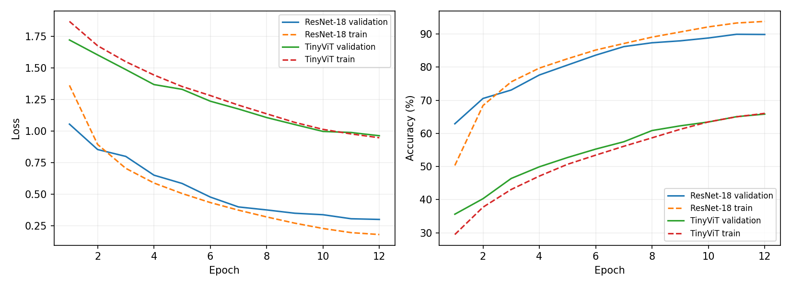
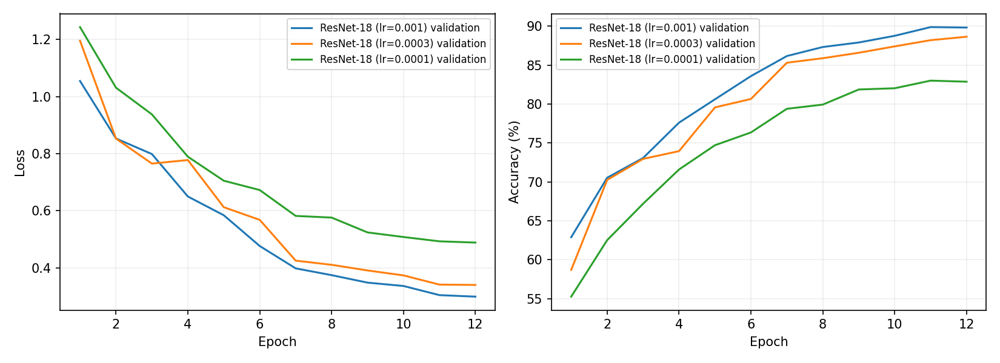
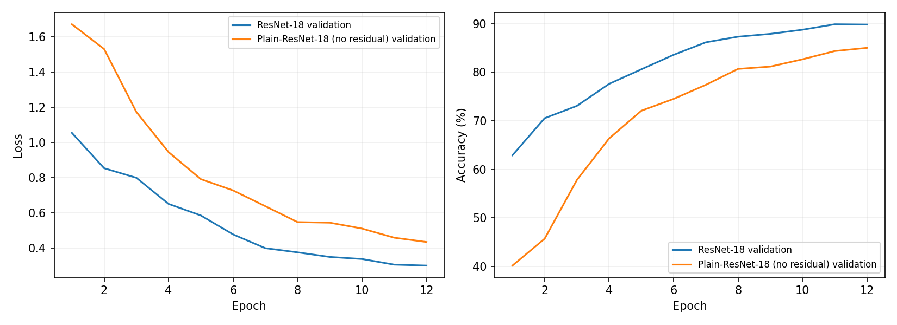

# CNN vs Vision Transformer on CIFAR-10

A PyTorch image-classification project comparing a CIFAR-adapted **ResNet-18** with a **compact Vision Transformer** trained from scratch. Additional experiments investigate learning-rate sensitivity and the effect of removing residual connections.

**Author:** Aditya Kumar

## Project questions

- How do a residual CNN and a compact ViT perform under the same short training schedule?
- How does the initial learning rate affect ResNet-18?
- What happens when the CNN's residual connections are removed?

## Recorded results

These numbers are taken from the retained outputs in the supplied notebook and agree with its accompanying report. They have not been independently reproduced for this GitHub package.

| Model | Trainable parameters | Best validation accuracy | Test accuracy | Training time |
| --- | ---: | ---: | ---: | ---: |
| ResNet-18 | 11,173,962 | 89.90% | **89.35%** | 3.9 min |
| Compact ViT (`TinyViT`) | 1,806,538 | 65.82% | 66.17% | 3.0 min |
| Plain ResNet without skip connections | 11,000,138 | 85.04% | 84.56% | 4.0 min |

ResNet-18 exceeded the compact ViT by **23.18 percentage points**. Removing CNN residual connections reduced test accuracy by **4.79 percentage points** in this run. Training times are rounded measurements from an NVIDIA RTX 5080 Laptop GPU and depend on the hardware and software environment.



| ResNet-18 initial learning rate | Best validation accuracy | Test accuracy |
| --- | ---: | ---: |
| 0.001 | 89.90% | **89.35%** |
| 0.0003 | 88.66% | 88.33% |
| 0.0001 | 83.02% | 83.35% |




The CSV files and figures in this package were extracted or reconstructed from the printed notebook outputs. Epoch losses, accuracies and times retain the logs' displayed precision; they are not the original full-precision history JSON files.

## Dataset and models

[CIFAR-10](https://www.cs.toronto.edu/~kriz/cifar.html) contains 32 × 32 RGB images across ten classes. The notebook downloads it through `torchvision` and uses 45,000 training images, 5,000 validation images and the official 10,000-image test set.

- **ResNet-18:** 3 × 3 stride-1 input convolution, no initial max-pooling, and a ten-class classifier. No pretrained weights.
- **Compact ViT:** custom implementation with 4 × 4 patches, 64 image tokens, a class token, positional embeddings, embedding dimension 192, six blocks, three attention heads and dropout 0.1. `TinyViT` is the local class name, not an implementation of the separate published TinyViT architecture.
- **Plain ResNet:** CNN with the same stage depths and widths, with residual additions and shortcut projections removed.

## Training configuration

| Setting | Value |
| --- | --- |
| Epochs per configuration | 12 |
| Batch size | 64 |
| Optimiser | AdamW |
| Default initial learning rate | 0.001 |
| Weight decay | 0.0005 |
| Scheduler | CosineAnnealingLR |
| Loss | Cross entropy |
| Seed | 42 |
| Checkpoint selection | Highest validation accuracy |

Training uses random cropping and horizontal flipping, followed by channel normalisation. **In the supplied code, the validation subset shares the augmented training dataset**, so validation also receives random crops and flips. Test images receive only tensor conversion and normalisation. This differs from the original report's description of validation preprocessing.

## Repository files

| Path | Purpose |
| --- | --- |
| `cifar10_cnn_vs_vit.ipynb` | Model definitions, all experiments, evaluation and retained outputs |
| `requirements.txt` | Required Python packages |
| `.gitignore` | Excludes datasets, generated checkpoints, caches and local environments |
| `results/model_comparison.csv` | Recorded architecture results |
| `results/learning_rate_comparison.csv` | Recorded learning-rate results |
| `results/epoch_metrics.csv` | Per-epoch metrics extracted from the logs |
| `assets/` | Three learning-curve figures shown above |

## Run the experiments

Use Python 3.12, matching the original notebook metadata. A GPU is recommended; the notebook falls back to CPU. Internet access is required for the initial dataset download.

```bash
python -m venv .venv
# Windows:
.venv\Scripts\activate
# macOS/Linux: source .venv/bin/activate
python -m pip install -r requirements.txt
python -m jupyterlab
```

Open `cifar10_cnn_vs_vit.ipynb` and run its cells in order from the repository root. The experiment cells generate the history JSON files used by the later plotting and summary cells. Running all cells retrains six configurations and writes model checkpoints; supplied checkpoint files are not required to train from scratch. Plots are saved to disk because the notebook uses Matplotlib's `Agg` backend.

The dependency list is intentionally unpinned because a complete original environment lockfile was not supplied. The recorded notebook reports PyTorch `2.12.1+cu130`, CUDA `13.0` and Python `3.12.13`; those recorded versions are not a validated installation requirement. Install a compatible PyTorch/torchvision pair for your environment using the [official PyTorch installer](https://pytorch.org/get-started/locally/). Exact results may differ across versions and hardware. This package has been checked for syntax and file consistency, but training was not rerun during packaging.

## Optional saved weights

Two supplied state dictionaries are distributed separately in `CIFAR10-Model-Weights.zip`:

- `resnet18_cifar10.pth`
- `tinyvit_cifar10.pth`

They are optional for the repository. If distributing them, attach the ZIP to a GitHub Release. Extract both files beside the notebook, keeping these exact names. No plain-network or learning-rate-study checkpoint was supplied.

To use these weights without retraining, run notebook sections 1–5 to define preprocessing, models and evaluation, then run section 10 to load the checkpoints and evaluate them. Skip sections 6–9, which train models or require generated history files. The retained section 10 outputs report 89.35% and 66.17% test accuracy; checkpoint loading has not been independently rerun during packaging.

## Limitations and next steps

- One seed and twelve epochs per configuration; no multi-seed uncertainty estimate.
- Different model capacities and no architecture-specific tuning; the results do not establish a general CNN-versus-ViT ranking.
- Validation uses stochastic augmentation. A future run should use a separate validation dataset with the same held-out indices and deterministic test preprocessing, then regenerate results.
- The ablation also removes shortcut projection parameters, so it is not an exactly parameter-matched comparison.
- Longer training, multi-seed evaluation, stronger augmentation and robustness experiments would extend the study.

## Technologies

Python · PyTorch · torchvision · NumPy · pandas · Matplotlib · Jupyter · convolutional networks · attention · image classification · model evaluation · hyperparameter experiments

## References

- [CIFAR-10 dataset — Alex Krizhevsky](https://www.cs.toronto.edu/~kriz/cifar.html)
- [Deep Residual Learning for Image Recognition — He et al.](https://arxiv.org/abs/1512.03385)
- [An Image is Worth 16×16 Words — Dosovitskiy et al.](https://arxiv.org/abs/2010.11929)
- [Decoupled Weight Decay Regularization — Loshchilov and Hutter](https://arxiv.org/abs/1711.05101)
